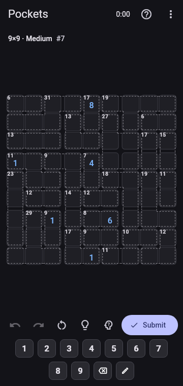
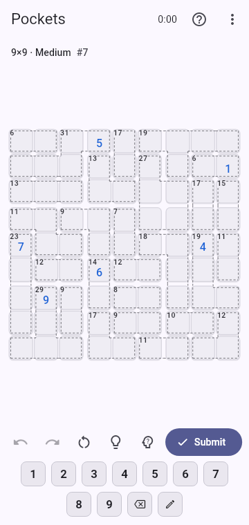
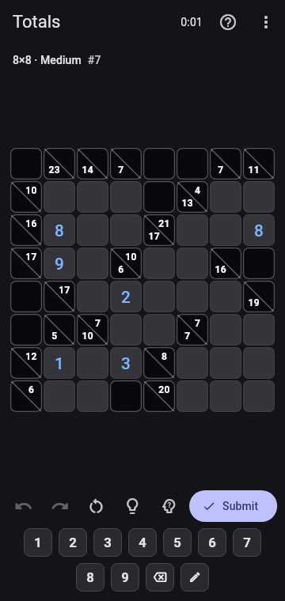
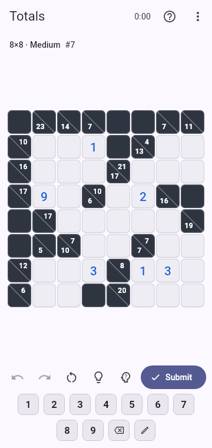
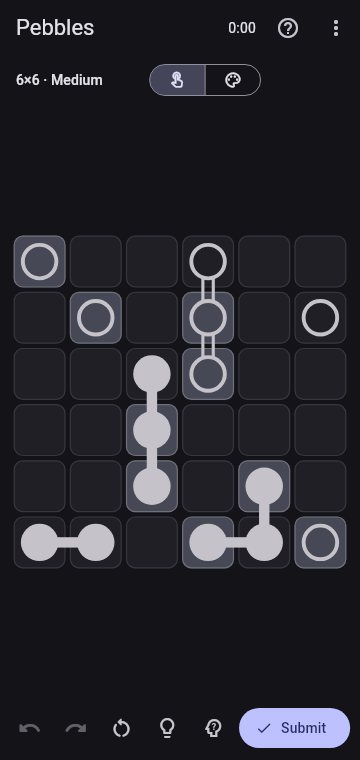
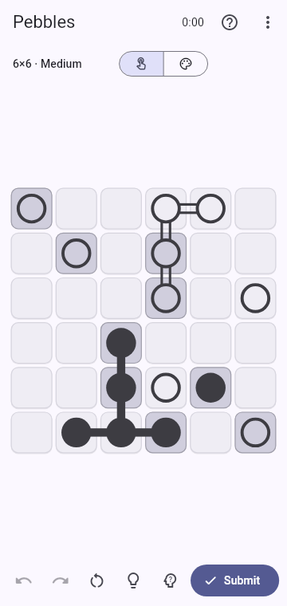
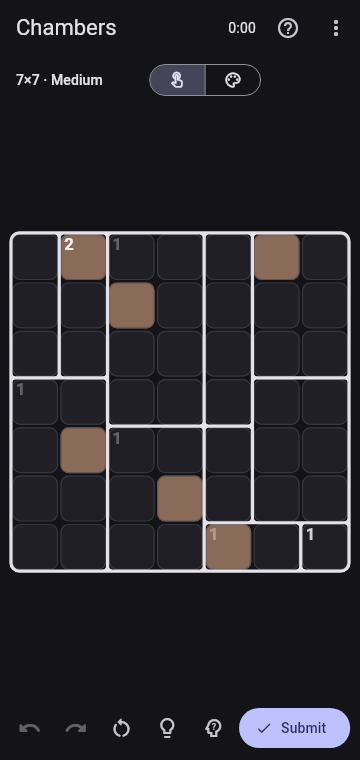
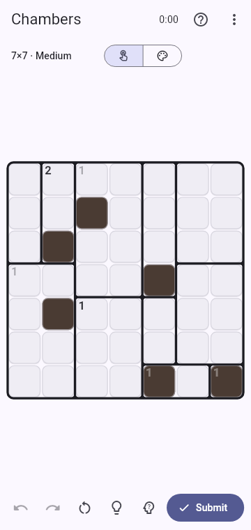
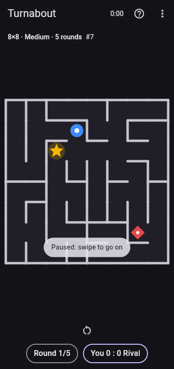
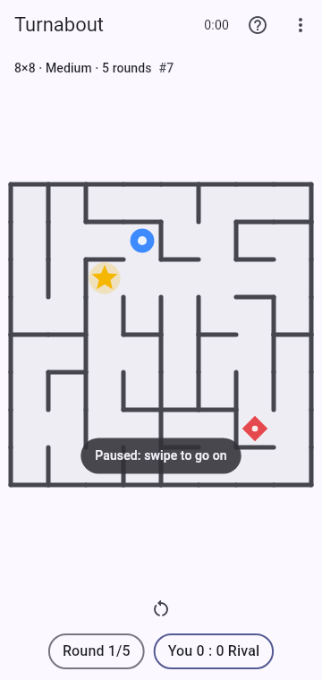

# Puzzles

Every game in APuzzle, grouped by the home screen's categories. Each one is shown in the dark and the light theme.

## Numbers

Sudoku and Pockets are one family on the home screen, Sudoku; Skyline, Cages and Signs are another, Latin squares.

| Dark | Light | Puzzle | Goal |
|---|---|---|---|
|  |  | **Sudoku** | 4×4, 6×6 or 9×9 grids. Every number appears once per row, column and box. Supports pencil marks. |
|  |  | **Pockets** | A Sudoku with no digits given: the grid is cut into dashed pockets instead. The digits of each pocket add up to the number in its corner and never repeat. 4×4, 6×6 or 9×9. Supports pencil marks. |
|  |  | **Skyline** | Put a tower in every cell, each height once per row and column. The clues around the grid say how many towers can be seen from there; taller towers hide shorter ones behind them. Supports pencil marks. |
|  |  | **Cages** | Fill the grid so every number appears once per row and column. The numbers in each outlined cage make the clue in its corner: added, multiplied, or, in a cage of two cells, subtracted or divided. Supports pencil marks. |
|  |  | **Signs** | Fill the grid so every number appears once per row and column. A sign between two cells points at the smaller number. Supports pencil marks. |
|  |  | **Totals** | A crossword of digits. Fill every empty cell with a digit from 1 to 9 so that each run of cells across or down adds up to the sum in the clue cell before it, with no digit twice in a run. Supports pencil marks. |
|  |  | **Blocks** | Fill every region of k cells with the numbers 1 to k. Equal numbers never touch, not even diagonally. Supports pencil marks. |
|  |  | **Tally** | Every cell holds a number. Cross some out so that the numbers left in each row and column add up to the sums outside the grid. |
|  |  | **Solo** | Every cell holds a number. Shade some so that no number shows twice in a row or column. Shaded cells never touch side by side, the cells left stay in one piece, and a shaded number must still show in its row or column. |
|  |  | **Dominoes** | A full set of dominoes lies on the grid with the outlines rubbed off. Split the numbers into dominoes of two neighbouring cells so that every pair, from 0–0 up to the highest double, shows up exactly once. |
|  |  | **Formula** | Guess the hidden equation in six tries. Every guess is a true equation, and each tile is marked as in place, elsewhere or not there. Six, eight or ten tiles wide; harder levels add × ÷, then brackets, squares and cubes. |
|  |  | **Plots** | Fill every cell with a number. Equal numbers that touch form a plot with exactly that many cells, and plots of the same size never touch. |
|  |  | **Shikaku** | Split the grid into rectangles. Each holds one number equal to its area. |

## Logic grids

| Dark | Light | Puzzle | Goal |
|---|---|---|---|
|  |  | **Sun & Moon** | Fill every cell with a sun or a moon. No three of the same in a row, equal counts in every row and column, and `=` / `×` clues between cells. |
|  |  | **Crowns** | Place one crown in every row, column and colored region. Crowns can't touch, not even diagonally. |
|  |  | **Pairs** | Shade exactly two cells in every region. Shaded cells come in side-by-side pairs, and pairs never touch each other. |
|  |  | **Hues** | Color the blank cells. Each number counts the blank cells around it (all 8 neighbors) that end up in its color. Supports pencil marks. |
|  |  | **Tetra** | Shade one L, I, T or S tetromino in every region. The shaded area is connected, with no 2×2 blocks, and identical shapes never touch across region borders. |
|  |  | **Campsite** | Pitch a tent next to every tree, one tent per tree. Tents never touch, not even diagonally, and the counts outside the grid give the tents per row and column. |
|  |  | **Fleet** | A fleet of straight ships hides in the grid, listed below it. Ships never touch, not even diagonally, the counts outside give the ship cells per row and column, and a few cells start shown: water or a ship piece whose shape tells where its ship goes on. |
|  |  | **Basins** | The grid is cut into basins. Fill them with water that settles from the bottom up to one level across each basin, so that every row and column holds the water count beside it. |
|  |  | **Pebbles** | Put a filled or a hollow stone in every cell. All filled stones form one connected group, so do all hollow ones, and no 2×2 block holds four stones of one kind. |
|  |  | **Chambers** | The grid is cut into rooms. Shade cells so that a room with a number holds that many shaded cells. Shaded cells never touch side by side, the unshaded cells stay in one piece, and no straight line of unshaded cells crosses two room borders. |
|  |  | **Islands** | Shade the sea. Every island holds one number equal to its size, islands never touch, and the sea is connected with no 2×2 pools. |
|  |  | **Lamps** | Place lamps that light their row and column up to the walls. Light every cell, never shine a lamp on another, and match the numbers on the walls. |
|  |  | **Orbits** | Give every star its own region. A region is one connected piece with its star in the exact middle, and it looks the same after half a turn around the star. |
|  |  | **Inlay** | Fit all the pieces from the tray into the shape, covering every cell with no overlaps. Pieces can be turned, and on hard boards flipped over too. Any way that fits them all wins. |
|  |  | **Mines** | Clear every cell without a mine. Numbers count the mines around them, and the start is chosen so that logic alone clears the board. |

## Paths & loops

Pipes and Channel are one family on the home screen, Plumbing.

| Dark | Light | Puzzle | Goal |
|---|---|---|---|
|  |  | **Trail** | Draw one path through every cell that passes the numbers in order. |
|  |  | **Links** | Join each pair of equal dots with a path. Paths never cross, and together they fill the whole grid. |
|  |  | **Labyrinth** | Walk through the maze from the top-left corner to the exit in the bottom-right corner. |
|  |  | **Homeward** | Drive the car along the roads to pick up every pet and bring it to the home with the same symbol. The car has only a few seats, every road costs fuel, and the fuel is just enough for a well-planned drive. |
|  |  | **Blockade** | Sail the boat to the harbour, one cell or one wait per turn. Patrol ships sail their drawn beats one cell after each of your turns: never end a turn on a ship's cell or swap places with one, and arrive within the turns you have. |
|  |  | **Pipes** | Rotate tiles until every pipe connects to the source, with no open ends and no loops. |
|  |  | **Channel** | Turn the tiles so that one pipe leads the water from the source to the drain. The other tiles don't matter and ends may stay open; water goes straight across a bridge, so the pipe can pass one twice. |
|  |  | **Atoms** | Connect atoms with single or double bonds that match their numbers. Bonds can't cross, and all atoms must end up connected. |
|  |  | **Fence** | Draw one loop along the grid lines. A number tells how many sides of its cell the loop uses. |
|  |  | **Pearls** | Draw one loop through the cell centres and every pearl: straight through white pearls (turning next to them), turning on black pearls (going straight next to them). |
|  |  | **Rails** | Lay one track from the entry on the left to the exit at the bottom. The counts outside the grid give the track cells per row and column, and given pieces are fixed. |
|  |  | **Arrows** | Shade some cells and draw one loop through all the others. Shaded cells never touch, and each arrow clue counts the shaded cells in its direction. |

## Casual

Mosaic and Blend are one family on the home screen, Flood; the memory games (Glimpse, Vanish, Hopper, Rebound) are another, Memory.

| Dark | Light | Puzzle | Goal |
|---|---|---|---|
|  |  | **Mosaic** | Flood the board with one color from the top-left corner, within the move limit. |
|  |  | **Blend** | Pick a color and repaint any patch; it merges with touching patches of that color. Make the board one color within the move limit. |
|  |  | **Pop** | Tap a group of touching same-colored bubbles to select it, tap again to pop it: n bubbles score n×(n−1). Modes: Standard, Shifter (rows slide right), Continuous (new columns roll in) and Mega (both). Goals: clear the board (Standard only, always possible), reach a target score, or free play for a best score. |
|  |  | **2048** | Slide the tiles and merge equal ones. Build the target tile (2048 on a hard 4×4), or play freely for a best score. New tiles come from the seed, so a share code replays the same game. |
|  |  | **Snake** | Steer the snake to the apples, grow longer and don't crash. Play for a best score or an apple target; the difficulty sets the speed. |
|  |  | **Junction** | Trains leave a tunnel one by one and run along a branching track. Tap the switches so each train reaches the station with its symbol. Route 20 trains, or as many as you can in two minutes; the difficulty sets the speed, how often trains leave and how many stations there are. |
|  |  | **Turnabout** | Race a rival through a maze to the star, which lies just as far from both of you. Every few seconds the whole maze turns, while your swipes stay screen-relative. Play 5 rounds, or until the rival has won three; the difficulty sets the rival's pace, the mazes and how often they turn. |
|  |  | **Glimpse** | Some cells light up for a moment: tap them all from memory. A round you get right lights one more cell next time, a miss one fewer. Play 10 rounds for a best score, or until your third miss. |
|  |  | **Vanish** | Numbers from 1 up appear on the grid. Tap 1 and the others hide: tap their cells in order from memory. A round you get right shows one number more next time, a miss one fewer. |
|  |  | **Hopper** | A frog hops from pad to pad, one jump at a time; then tap the pads it landed on, in the same order or backwards (a game option). Each round you get right adds a jump, a miss takes one away. |
|  |  | **Rebound** | Remember the bumpers on the grid; once they hide, a ball rolls in at the arrow, and every bumper it meets turns it. Tap the edge where it leaves. Each round you get right adds a bumper, a miss takes one away. |
