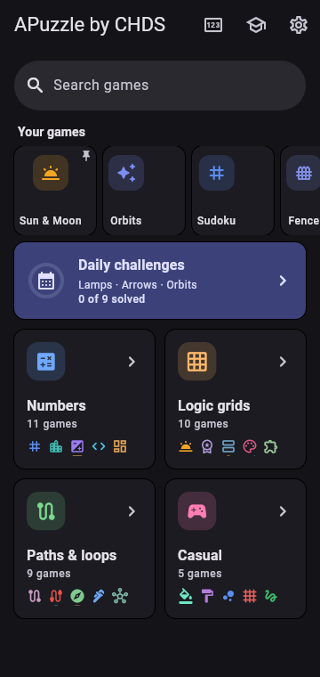
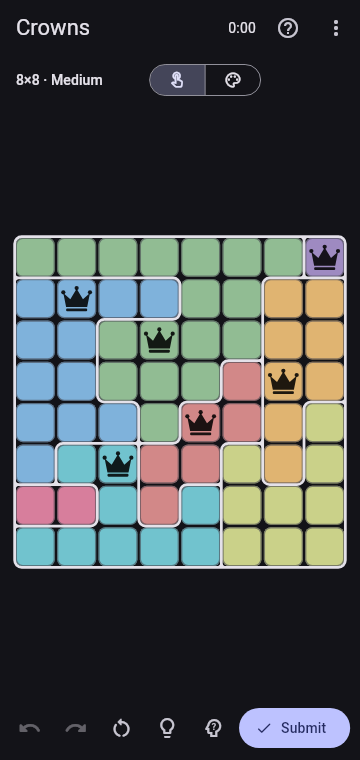
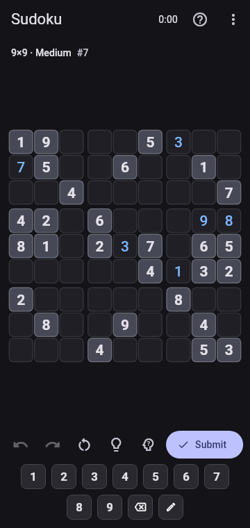

# APuzzle

> ### ▶ [Play in your browser: jncchds.github.io/apuzzle](https://jncchds.github.io/apuzzle/)
> No install needed: the web version has every game, the daily challenges, the tutorials and explain mode, and it saves your progress in the browser.
>
> **Prefer an app?** Download it from the [latest release](https://github.com/jncchds/apuzzle/releases/latest): an `.apk` for Android and a `.zip` for Windows.

A collection of grid logic puzzles for Android, Windows, iOS and the web, built with Flutter.
Every puzzle is **generated on the device**, and a solver checks that it has **exactly one solution**.
Mines is solved by logic without guessing. The casual games (the color floods, Pop, 2048, Nightfall, Snake, Junction, Turnabout and the memory games), Formula, Homeward and Blockade are played for a move limit, a target or a best score instead; their limits and targets come from solver playthroughs or the board size, so they are always reachable (Nightfall's move limit from the exact fewest taps, Homeward's fuel and Blockade's turns come from the exact shortest plan).
You choose the grid size and the difficulty.

<p align="center">
  
  
  
</p>

## Puzzles

57 games in four categories. See [PUZZLES.md](PUZZLES.md) for the rules of each, with screenshots in both themes.

- **Numbers:** Sudoku, Pockets, Skyline, Cages, Signs, Totals, Blocks, Tally, Solo, Dominoes, Formula, Plots, Shikaku
- **Logic grids:** Sun & Moon, Crowns, Pairs, Hues, Tetra, Campsite, Fleet, Basins, Mercury, Poles, Pebbles, Chambers, Lookout, Rampart, Islands, Lamps, Orbits, Inlay, Mines
- **Paths & loops:** Trail, Links, Waymarks, Labyrinth, Homeward, Blockade, Pipes, Channel, Atoms, Fence, Pearls, Rails, Arrows
- **Casual:** Mosaic, Blend, Pop, 2048, Nightfall, Snake, Junction, Turnabout, Glimpse, Vanish, Hopper, Rebound

## Features

- **Endless puzzles.** Generation is seeded and deterministic, and runs in a background isolate.
- **Daily challenges.** Every day picks three games, each at every difficulty, the same for everyone. Results are kept in a calendar, and you can choose which games the days draw from.
- **Interactive tutorials.** Every game teaches its rules on a few tiny boards you play, ending with a small real one. Optional strategy lessons then show the techniques strong players use, each on a board that needs it.
- **Explain mode.** For every logic puzzle, the button next to Hint explains the next step in words ("E4 must be a crown, because…"), highlights the cells it talks about, and can play the step for you.
- **Memory games.** Glimpse, Vanish, Hopper and Rebound show something for a moment (or until you tap Ready), hides it, and asks for it back. Rounds get harder as you get them right and easier after a miss; play a set number of rounds or until your third miss, for a best score. Rounds come from the seed, so a share code replays the same game.
- **Real-time games.** Snake, Junction and Turnabout run on their own clock: they wait for your first move, pause with a tap (or when you leave the app), and draw everything that happens from the seed, so a share code replays the same game.
- **Share codes.** Every puzzle has a code (and a link on the web) that recreates it exactly.
- **Exactly one solution.** Most types are also graded by how deep the solver's logic has to go (easy, medium, hard, and expert for Sudoku).
- **Game options.** A puzzle can offer extra choices when you start a game, like Pop's mode and goal. They are part of the share code, and stats are kept per choice.
- **Variable grid sizes.** A size is only offered if it fits the screen, so there's no zooming.
- **Two input styles.** Tap a cell to cycle its values, or pick a value from a palette and stamp it. Slide across cells to mark them all in one go. Pencil marks are available where useful.
- **Notes done for you.** In Crowns, Campsite, Pairs and Fleet, a long press dots every cell that the pieces you have placed already rule out. In Basins it lets the water settle: it fills the cells below your water and marks the cells it can't reach dry; in Mercury it fills each tube back to the bulb from your mercury and marks empty the cells past your empty marks. In Poles it finishes the dominoes you started and dots the rest of every line that has all its + and − cells.
- **Checked on submit.** Mistakes aren't highlighted while you play; live highlighting is an option in Settings.
- **Undo, redo, restart and hints.** There's a timer, and stats (best time, or best score for the score games) are kept per puzzle and difficulty.
- **Auto-save.** Leave at any time and continue where you stopped.
- **Move your progress.** Export wins, best times, daily results and saved games as a file or as text, and import them on another device; importing merges and never replaces.
- **Portrait and landscape.** Turn the phone or widen the window, and the board fills the height with the controls in a side panel.
- **A tidy home screen.** Search at the top, then your games (the ones you pinned and played last), the daily challenge and one tile per category (Numbers, Logic grids, Paths & loops, Casual). A category lists its games; games that are variants of one idea share a family page. Search finds games by name, by what you do in them ("draw a loop", "shade cells") in any of the four languages, and by other names the puzzles are known by; it forgives typos, and when nothing matches it shows the closest games, also by part of a word. Long-press a game, or use the pin on its new-game sheet, to pin it.
- **Animations.** Cells pop and fade, pipes rotate, colors flood, bubbles fall and slide, and solving plays a ripple with confetti.
- **Light and dark themes** (Material 3).
- **Four languages:** English, Ukrainian, Polish and German.
- **Release notes** in Settings, also in [RELEASE_NOTES.md](RELEASE_NOTES.md).

## Getting started

Requirements:
- **Flutter** stable 3.47 or newer, with Dart 3.13 or newer.
- **Android:** the Android SDK, with licenses accepted via `flutter doctor --android-licenses`.
- **Windows desktop:** Visual Studio 2022 with the *Desktop development with C++* workload, and Windows *Developer Mode* turned on (plugins need symlinks).

```bash
flutter pub get
```

```bash
flutter run -d windows
```

```bash
flutter run -d chrome
```

```bash
flutter build apk --release
```

## Tests

```bash
flutter analyze
```

```bash
flutter test
```

For every puzzle type, the generator tests check the following across sizes, difficulties and seeds:
- the solution is valid;
- the puzzle has exactly one solution;
- it can be solved at its target logic tier;
- generation is deterministic;
- generation is fast.

The screenshots above come from a snapshot harness, which renders every game screen at phone size (dark and light) to `build/snapshots/`:

```bash
flutter test test/snapshots --run-skipped --tags snapshot
```

## Architecture

```
lib/
  core/
    puzzle_type.dart      plug-in contract every puzzle implements
    value_grid.dart       base for "one value per cell" puzzles (input, palette, pencil marks, hints)
    lattice_loop.dart     shared loop solver for Fence, Pearls, Rails and Arrows
    latin_square.dart     shared Latin-square candidates, rules, generator and explainer (Skyline, Cages, Signs)
    game_controller.dart  session: state history (undo/redo), timer, submit, hints, save/resume, stats
    generator_runner.dart runs generation off the UI thread
    daily.dart            daily challenges
    tutorial.dart         tutorial and strategy steps
    explain.dart          explain mode: traced solver deductions turned into steps and texts
    backup.dart           progress export and import
    registry.dart         puzzle types, grouped into families and home-screen categories
    search.dart           game search: tags, other names, accent-insensitive word-prefix matching
    recall.dart           shared rounds, levels, score and goals of the memory games (board in ui/board/recall_board.dart)
  ui/                     home, category and family pages (browse_screens.dart), new-game sheet, game, daily, learn and settings screens, board widgets
  puzzles/<id>/           model, solver, generator, type, tutorial and explainer for each puzzle
  l10n/                   texts in four languages (ARB files)
test/                     generator and solver tests per puzzle, tutorial, explain and controller tests, snapshots
```

To add a puzzle:
1. Create `lib/puzzles/<id>/`.
2. Implement `PuzzleType` (or `ValueGridType` for tap-to-fill grids). This needs:
   - an immutable puzzle and state;
   - a sound solver that can count solutions;
   - a seeded generator;
   - a tutorial, and an explainer if the puzzle is solved by deduction.
3. Register the type in `lib/core/registry.dart` (in a family of a category), and give it search tags and any other names it is known by in `lib/core/search.dart`.
4. Add tests.
5. Add it to its group's table above, with a dark and a light screenshot in `docs/screenshots/`.

## Status

The Tetra and Skyline generators are currently limited to 7×7. At larger sizes, proving the solution is unique (Tetra) or grading a hard board (Skyline) is still too slow to do on the device.

## Credits

APuzzle was written with [Claude Code](https://claude.com/claude-code), using Anthropic's Claude Opus 5.5 model.

## License

[MIT](LICENSE) © 2026 Kirill Chekanov.
